# Smart Delivery Date: User Guide

Version 2.0.0 · For Magento Open Source and Adobe Commerce 2.4.6 – 2.4.9 · Luma and Hyvä themes

Smart Delivery Date tells shoppers when their order will arrive and lets them choose a
delivery date at checkout. It knows your processing days, your carrier's delivery days, your
daily cut-off time and your holidays, and it never lets a customer place an order for a day
you cannot deliver.

---

## Contents

1. [What the customer sees](#1-what-the-customer-sees)
2. [Installation](#2-installation)
3. [Quick start (5 minutes)](#3-quick-start-5-minutes)
4. [Configuration reference](#4-configuration-reference)
5. [How the delivery date is calculated](#5-how-the-delivery-date-is-calculated)
6. [Customer delivery date selection](#6-customer-delivery-date-selection)
7. [Multi-address checkout](#7-multi-address-checkout)
8. [Per-product processing time](#8-per-product-processing-time)
9. [Where the chosen date appears](#9-where-the-chosen-date-appears)
10. [Hyvä themes](#10-hyvä-themes)
11. [Translating and customising texts](#11-translating-and-customising-texts)
12. [Troubleshooting](#12-troubleshooting)
13. [Uninstalling](#13-uninstalling)
14. [Support](#14-support)

---

## 1. What the customer sees

| Page | What is shown |
| --- | --- |
| Product page | "Order within **3h 12m** and get it on **Friday, October 23**" with a live countdown to your cut-off time. |
| Shopping cart | The same message, calculated for the whole cart (the slowest product decides). |
| Checkout, shipping step | The estimate and a **Preferred Delivery Date** calendar. Days that cannot be delivered are greyed out and cannot be clicked. |
| Multi-address checkout | The estimate on the address step, and an estimate plus a delivery date list **for every shipping address** on the shipping step. The chosen dates are listed on the review step. |
| My Account → My Orders | The chosen delivery date on the order page. |

When the cut-off time passes, the message and the calendar update automatically without reloading the page.

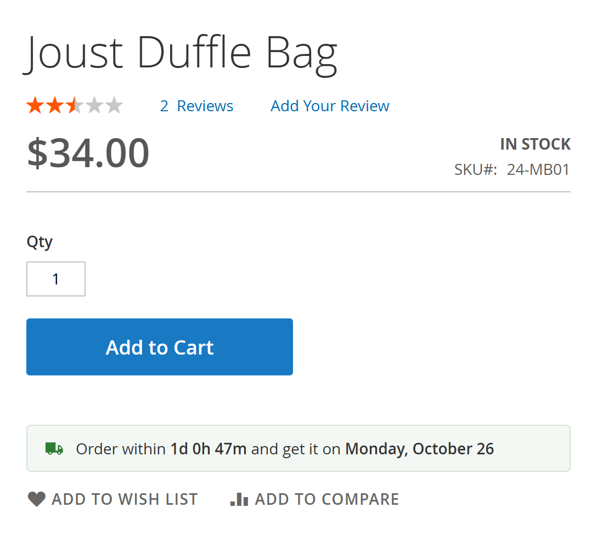
*Product page: estimate with live cut-off countdown*

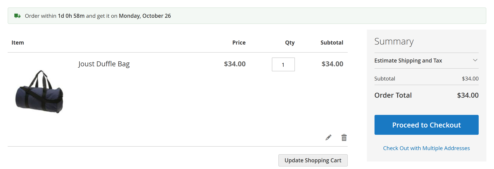
*Shopping cart: estimate for the whole cart*


---

## 2. Installation

### Composer (recommended)

```bash
composer require ecommet/module-smart-delivery-date
bin/magento module:enable Ecommet_SmartDeliveryDate
bin/magento setup:upgrade
bin/magento setup:di:compile          # production mode only
bin/magento setup:static-content:deploy -f   # production mode only
bin/magento cache:flush
```

### Manual (ZIP)

1. Create the folder `app/code/Ecommet/SmartDeliveryDate`.
2. Extract the ZIP into it, so that `registration.php` is at `app/code/Ecommet/SmartDeliveryDate/registration.php`.
3. Run the commands above, starting at `module:enable`.

Installation adds:

* a `Processing Time (days)` product attribute (group **Smart Delivery Date**);
* an `ecommet_delivery_date` column on the quote, quote address, order and order grid tables.

---

## 3. Quick start (5 minutes)

Go to **Stores → Configuration → Ecommet Extensions → Smart Delivery Date**.

1. **General → Enable Smart Delivery Date**: *Yes*.
2. **Order Processing**
   * Processing Days: the weekdays your warehouse ships, e.g. Monday–Friday.
   * Processing Time (days): how long you need to prepare an order, e.g. *1*.
   * Same-day Cut-off Time: e.g. *14:00*. Orders placed later start the next processing day.
   * Excluded Processing Dates: click **Add Date** for each holiday. Tick **Every Year** = *Yes* for fixed holidays such as 25 December.
3. **Delivery**
   * Carrier Delivery Days: e.g. Monday–Friday.
   * Transit Time (days): e.g. *2*.
   * Carrier Uses the Same Excluded Dates: *Yes*, or *No* to enter separate carrier holidays.
4. **Customer Delivery Date Selection**
   * Allow Customers to Choose a Delivery Date: *Yes*.
   * Delivery Date Is Required: *Yes* if every order must have a date.
5. **Save Config** and flush the cache (**System → Cache Management**).

Open any product page: the estimate appears below the Add to Cart button.

> **Tip.** Set the store timezone correctly (**Stores → Configuration → General → Locale Options → Timezone**). All dates and the cut-off time use it, whatever the server or the shopper's timezone.

---

## 4. Configuration reference

Scope: **G** = default, **W** = website, **S** = store view.

### General

| Field | Scope | Default | Description |
| --- | --- | --- | --- |
| Enable Smart Delivery Date | G W S | No | Master switch. When *No*, nothing is shown and no date is validated. |

### Order Processing (your warehouse)

| Field | Scope | Default | Description |
| --- | --- | --- | --- |
| Processing Days | G W | Mon–Fri | Weekdays on which orders are prepared. |
| Processing Time (days) | G W | 1 | Processing days before the order is handed to the carrier. *0* = ships the day it is processed. Can be overridden per product ([section 8](#8-per-product-processing-time)). |
| Same-day Cut-off Time | G W | 14:00 | Orders placed after this time start processing the next processing day. Drives the countdown. *00:00:00* means "no cut-off" (end of day). |
| Excluded Processing Dates | G W | – | Holidays and closures. Each row: **Date**, **Description** (for your reference only), **Every Year** (repeat on the same day and month every year). |

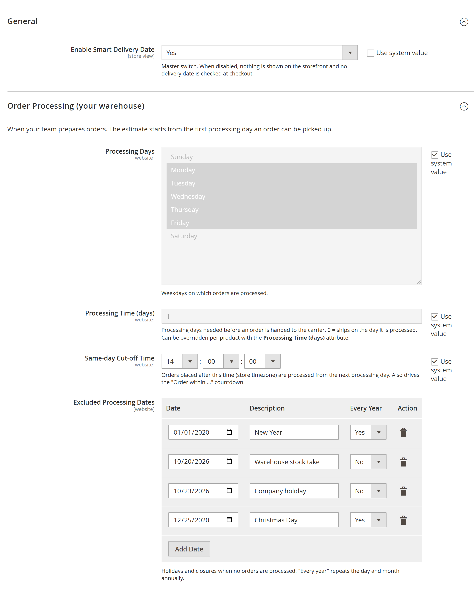
*General and Order Processing settings*

### Delivery (your carrier)

| Field | Scope | Default | Description |
| --- | --- | --- | --- |
| Carrier Delivery Days | G W | Mon–Fri | Weekdays on which the carrier collects and delivers. |
| Transit Time (days) | G W | 2 | Carrier delivery days between hand-over and delivery. |
| Show a Delivery Window | G W | No | Show "between Monday and Wednesday" instead of one date. |
| Delivery Window Length (days) | G W | 2 | Carrier delivery days added to the earliest date to get the latest date. |
| Carrier Uses the Same Excluded Dates | G W | Yes | *Yes*: your excluded processing dates also block delivery. *No*: use the list below. |
| Excluded Delivery Dates | G W | – | Days the carrier does not deliver (shown when the previous field is *No*). |

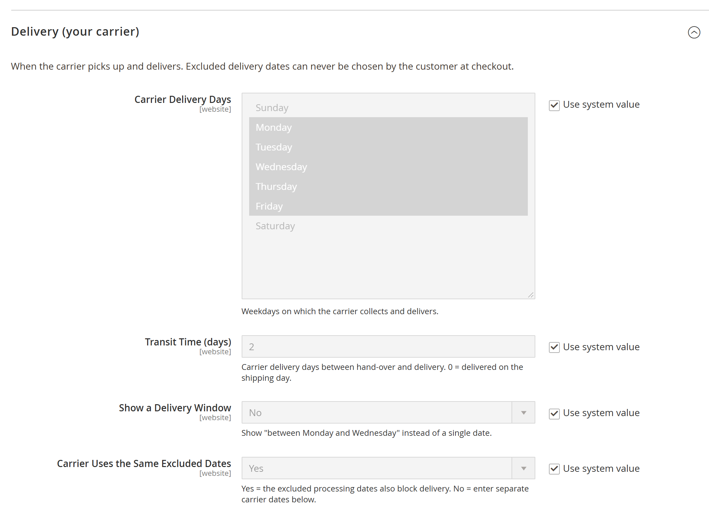
*Delivery settings*

### Customer Delivery Date Selection

| Field | Scope | Default | Description |
| --- | --- | --- | --- |
| Allow Customers to Choose a Delivery Date | G W S | Yes | Shows the calendar at checkout. |
| Delivery Date Is Required | G W S | No | *Yes*: the customer cannot continue or place the order without a date. *No*: the field is optional ("as soon as possible"). |
| Selectable Period (days) | G W | 30 | How many calendar days after the earliest delivery date can be chosen. |
| Field Label | G W S | – | Custom label. Empty = "Preferred Delivery Date". |
| Note Below the Field | G W S | – | Optional text under the field, e.g. "We deliver between 9:00 and 18:00." |

### Storefront Display

| Field | Scope | Default | Description |
| --- | --- | --- | --- |
| Show Estimate on Product Page | G W S | Yes | |
| Show Estimate in Shopping Cart | G W S | Yes | |
| Show Estimate at Checkout | G W S | Yes | One-page checkout (shipping step) and multi-address checkout. |
| Hide Estimate for Out-of-Stock Products | G W S | Yes | No estimate for products that cannot be bought. Virtual and downloadable products never show one. |
| Show Cut-off Countdown | G W S | Yes | *No*: "Order now and get it on …". |
| Date Format | G W S | `EEEE, MMMM d` | ICU pattern, localised to the store locale. `EEE d MMM` → "Fri 23 Oct"; `dd/MM/yyyy` → "23/10/2026". |
| Message With Countdown | G W S | – | Empty = "Order within {countdown} and get it {delivery}". |
| Message Without Countdown | G W S | – | Empty = "Order now and get it {delivery}". |

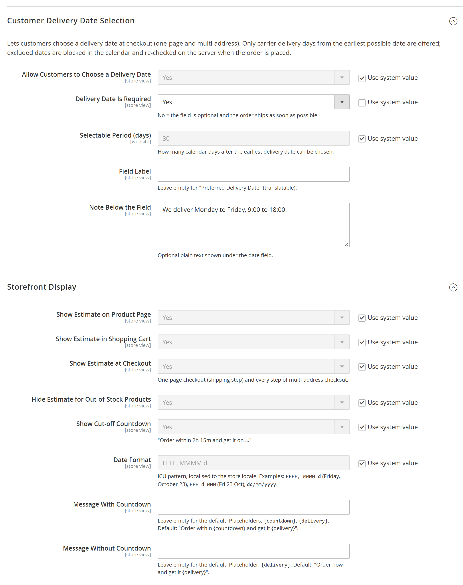
*Customer Delivery Date Selection and Storefront Display settings*

---

## 5. How the delivery date is calculated

All steps use the **store timezone**.

1. **Start day.** If today is a processing day *and* it is before the cut-off time, processing starts today. Otherwise it starts on the next processing day.
2. **Processed.** Add the *Processing Time* in processing days, skipping non-processing weekdays and excluded processing dates.
3. **Shipped.** The first carrier delivery day on or after the processed day.
4. **Earliest delivery.** Add the *Transit Time* in carrier delivery days, skipping excluded delivery dates.
5. **Latest delivery** (delivery window only). Add the *Delivery Window Length* in carrier delivery days.

### Worked example

Settings: processing Mon–Fri, processing time 1, cut-off 14:00, carrier Mon–Fri, transit 2,
excluded date **Tuesday 20 October** (carrier uses the same dates).

| Order placed | Start | Processed | Shipped | Earliest delivery |
| --- | --- | --- | --- | --- |
| Mon 19 Oct, 10:00 | Mon 19 | Wed 21 (Tue excluded) | Wed 21 | Fri 23 |
| Mon 19 Oct, 15:00 (after cut-off) | Wed 21 (Tue excluded) | Thu 22 | Thu 22 | Mon 26 |
| Sat 24 Oct | Mon 26 | Tue 27 | Tue 27 | Thu 29 |

---

## 6. Customer delivery date selection

On the shipping step of the one-page checkout the customer sees a calendar:

* the first selectable day is the **earliest delivery date**;
* the last selectable day is the earliest date + **Selectable Period**;
* carrier days off, **excluded delivery dates** and recurring holidays are **greyed out and cannot be clicked**.

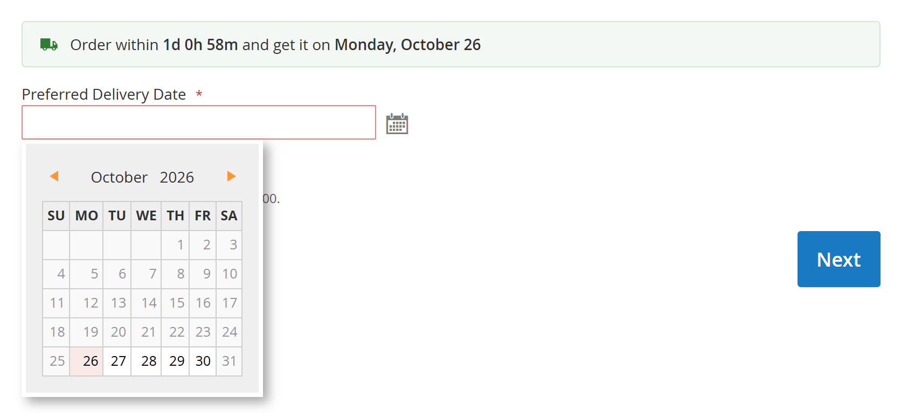
*Checkout: only deliverable days can be picked*

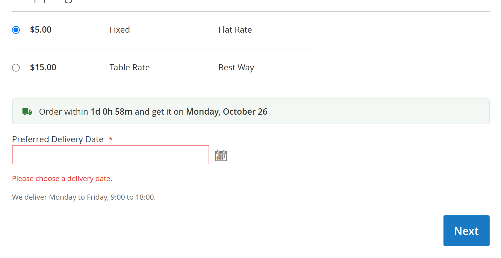
*Checkout: a required date must be chosen before continuing*

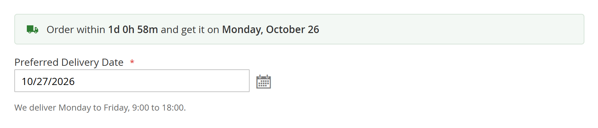
*Checkout: date chosen*

### The date is enforced on the server

The calendar is only a convenience. The date is checked again on the server:

1. when the shipping step is submitted, and
2. **at the moment the order is placed.**

Check 2 matters because an estimate can move on while the customer is checking out (the
cut-off time passes, or you add a holiday). If the chosen date is no longer possible, or is
an excluded date, a weekend without carrier service or an invalid value, the order is **not**
placed. The customer sees, for example:

> We cannot deliver on Friday, October 23. Please choose another delivery date (earliest: Monday, October 26).

The same rules apply to orders placed through the REST API: the date is sent as
`addressInformation.extension_attributes.ecommet_delivery_date` (`YYYY-MM-DD`) to
`/V1/carts/mine/shipping-information` or `/V1/guest-carts/:cartId/shipping-information`.

Orders created by an administrator in **Sales → Orders → Create New Order** are not restricted.

---

## 7. Multi-address checkout

Multi-address checkout ("Check Out with Multiple Addresses" in the cart) is fully supported:

* **Address step:** the delivery estimate for the cart, with countdown.
* **Shipping method step:** for every address, the estimate for the items shipped there and a
  **Preferred Delivery Date** list containing only deliverable dates.
* **Review step:** a **Delivery Dates** box listing the date chosen for each address.
* Each resulting order stores the date chosen for its address.

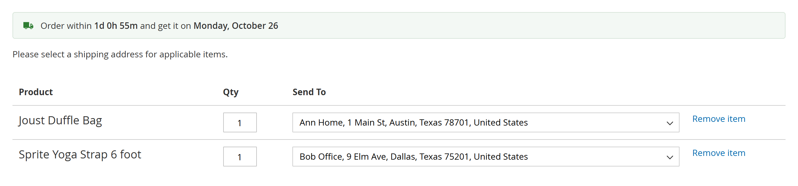
*Multi-address checkout: estimate on the address step*

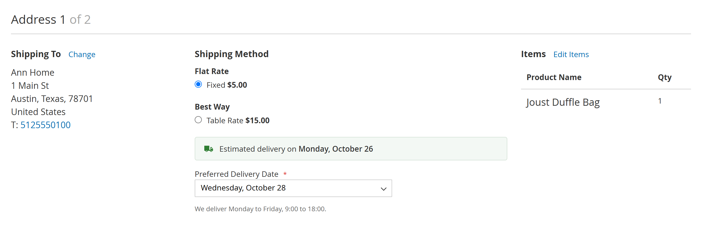
*Multi-address checkout: estimate and delivery date for each address*


*Multi-address checkout: chosen dates on the review step*

The same server checks apply. An excluded or expired date sends the customer back to the
shipping method step with a message, and no order is placed.

---

## 8. Per-product processing time

Products that take longer to prepare (made-to-order, engraving, …) can have their own processing time:

1. **Catalog → Products → edit a product**.
2. Open the **Smart Delivery Date** group.
3. Set **Processing Time (days)**, e.g. *5*. Leave it empty to use the configuration value.

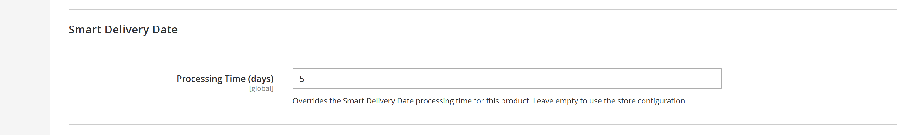
*Product edit page: Processing Time (days)*

In the cart and at checkout the **slowest product decides** the estimate. For configurable
products the value of the selected child product is used if set, otherwise the parent's.

---

## 9. Where the chosen date appears

| Place | Details |
| --- | --- |
| Admin order view | **Sales → Orders → View**, section **Delivery Date**. |
| Admin order grid | Column **Delivery Date** (enable it in **Columns**), with a date-range filter. |
| Customer account | **My Account → My Orders → View Order**. |
| Order confirmation e-mail | Add the variable to your template (below). |
| REST API | `GET /V1/orders/:id` → `extension_attributes.ecommet_delivery_date`. |

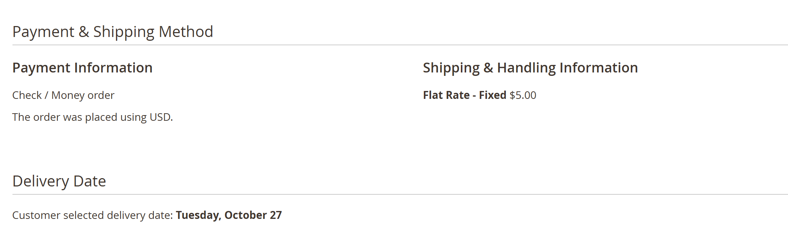
*Admin order view: Delivery Date section*

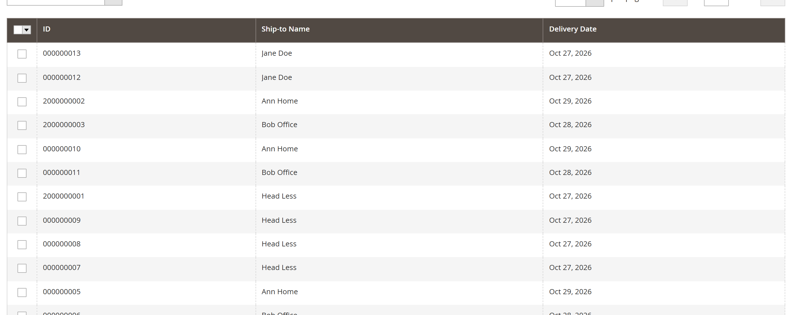
*Admin order grid: Delivery Date column*

### Adding the date to the order e-mail

1. **Marketing → Email Templates → Add New Template**, load **New Order** (or **New Order for Guest**), **Load Template**.
2. Add, for example after the shipping method:

   ```
   {{depend ecommet_delivery_date}}
   <p><strong>{{trans "Delivery Date"}}:</strong> {{var ecommet_delivery_date}}</p>
   {{/depend}}
   ```

3. Save, then select the template in **Stores → Configuration → Sales → Sales Emails → Order**.

---

## 10. Hyvä themes

Hyvä templates are included; no compatibility module is needed.

* **Product page and cart:** Alpine.js components, written in the CSP-friendly style Hyvä recommends (registered with `Alpine.data`, inline script registered with Hyvä's CSP helper). Tested with Hyvä 1.5.3.
* **Tailwind:** the module registers its templates with the Hyvä build automatically. Rebuild your theme CSS once after installing:

  ```bash
  bin/magento hyva:config:generate
  cd app/design/frontend/<Vendor>/<theme>/web/tailwind && npm run build
  ```

* **One-page checkout:** Hyvä stores use the Luma checkout through the free Hyvä Luma Checkout
  fallback (`hyva-themes/magento2-luma-checkout`). The delivery date calendar works there
  unchanged. The paid **Hyvä Checkout** product is not supported yet.
* **Multi-address checkout:** the Hyvä theme has no multi-address checkout templates, so it
  also has to fall back to Luma. In **Stores → Configuration → Hyvä Themes → Theme Fallback →
  List of path parts**, add a row `multishipping/checkout`. The delivery date fields then work
  as described in [section 7](#7-multi-address-checkout).

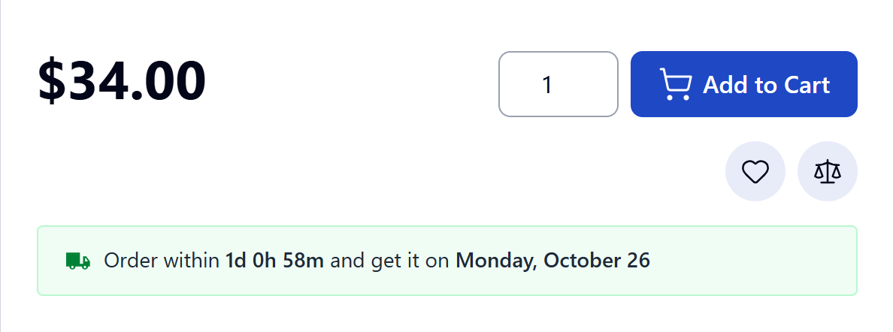
*Hyvä theme: product page estimate*

---

## 11. Translating and customising texts

* All texts are translatable (`i18n/en_US.csv`). Copy it to `i18n/<locale>.csv` in your theme or a language pack.
* Storefront messages can be changed per store view in **Storefront Display → Message With / Without Countdown**. Keep the placeholders:
  * `{countdown}`: time left until the cut-off;
  * `{delivery}`: "on Friday, October 23" or "between … and …".
* Dates follow the store locale (**Locale Options → Locale**) and the **Date Format** pattern.

---

## 12. Troubleshooting

| Problem | Solution |
| --- | --- |
| No estimate on the product page | Check that the module is enabled for the store view, **Show Estimate on Product Page** is *Yes* and the product is in stock and not virtual. Flush the cache. |
| Estimate is one day off | Check the store **Timezone** and the **Same-day Cut-off Time**. |
| Estimate never appears | At least one **Processing Day** and one **Carrier Delivery Day** must be selected. A warning is written to `var/log/system.log` if no working day can be found. |
| Customers can pick a holiday | Add it to **Excluded Delivery Dates**, or to **Excluded Processing Dates** with **Carrier Uses the Same Excluded Dates** = *Yes*. |
| Calendar not shown at checkout | **Allow Customers to Choose a Delivery Date** = *Yes*, and the cart must contain a physical product. |
| Changes not visible | Flush the cache. In production mode also run `setup:static-content:deploy`. |

---

## 13. Uninstalling

```bash
bin/magento module:disable Ecommet_SmartDeliveryDate
composer remove ecommet/module-smart-delivery-date   # Composer installs
bin/magento setup:upgrade
```

> **Your data.** Magento's declarative schema drops the `ecommet_delivery_date` columns on the
> next `setup:upgrade` once the module is disabled or removed, so the dates chosen on past
> orders are lost. To keep them, export the orders first (Sales → Orders → Export), or just set
> **Enable Smart Delivery Date** to *No* instead of disabling the module.

For Composer installs, `bin/magento module:uninstall Ecommet_SmartDeliveryDate` does everything
in one step and also removes the **Processing Time (days)** product attribute.

---

## 14. Support

📧 ecommet.solutions@gmail.com · 🌐 https://ecommet.in
